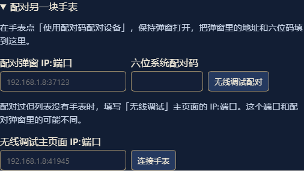

# DSH Watch first connection

[Project](../README.en.md) · [简体中文](INSTALL.zh.md) · [Help](HELP.en.md)

## Before you start

- Run DeepSeek Harness on your computer. The watch needs Android 11 or later. Use Smart mode on Xiaomi Watch 5.
- Put the watch and the computer on the same local network. Keep the watch awake and unlocked for setup.
- ADB is required. On Windows x64 the wizard can download it from Google. On other systems, install [Android SDK Platform-Tools](https://developer.android.com/tools/releases/platform-tools) and make `adb` available to DSH.

## 1. Install the desktop plugin

In the DSH instance you use, open Plugins → Plugin Market, search for `dsh-watch`, install it, and enable it under Installed if it is off. Reload DSH when prompted. If your market has yet to refresh, download `dsh-watch.tgz` from [GitHub Releases](https://github.com/cyuni1996/dsh-watch/releases) and add the file or its download URL in the plugin manager.

For a Web profile you manage from a terminal, for example:

```sh
dsh plugin --profile web add https://github.com/cyuni1996/dsh-watch/releases/latest/download/dsh-watch.tgz
```

Restart that same Web profile. Use the in-app plugin manager for DSH Desktop, which manages its own profile.

### Install through DSH Discover

If your DSH version supports Custom plugin indexes, turn it on under Plugins → Experimental plugins. In Discover → Add index source, enter:

```text
https://raw.githubusercontent.com/cyuni1996/dsh-watch/main/plugin-market.json
```

Select DSH Watch and check that the source is `cyuni1996/dsh-watch`. After installation, check the plugin switch under Installed. To update, open the DSH Watch title in Discover and choose Install next to the recommended version.

## 2. Open the installation wizard

In Settings → Watch connection, select a LAN address the watch can reach and save the connection settings. The default port is `8767`. Open the watch installation wizard and check that it reports the debugging tools are ready.

## 3. Pair wireless debugging and install the app

1. Open About or My device on the watch and tap the system version repeatedly to enable Developer options.
2. In Developer options → Wireless debugging, allow the current network and open Pair device with pairing code. Keep the dialog open.
3. Enter the IP and port shown in that **pairing dialog**, plus its **six-digit system code**, in the desktop wizard and pair wireless debugging.
4. Refresh devices, select the watch, and choose Install / update DSH Watch. If your watch is already listed, go straight to this step.
5. If debugging is paired but the watch remains missing, use the IP and port shown on the **main wireless debugging screen** and choose Connect watch. The two screens may use different ports.



## 4. Connect to DSH and verify

Select the desktop address you saved, then choose Connect to DSH and open. The wizard verifies the connection and opens the watch app. When the watch shows Online, send a short message and confirm that it appears in the same desktop conversation. You can turn off wireless debugging after that.

The wizard authorizes the watch automatically. The **ten-digit code generated on the desktop** is for manual app pairing. See [Help](HELP.en.md) for manual and remote connections.

## Updates

- **Desktop plugin.** Check for an update in the market of the same DSH profile, or update with the current Release's `dsh-watch.tgz`. Reload DSH.
- **Watch app.** When the release includes a newer watch app, enable wireless debugging and use Install / update DSH Watch for the original device. An update with the same signature preserves app data.
- **Signature conflict.** Preserve the existing app and confirm the signing source before changing anything. An APK with a different signature cannot update it in place. Uninstalling clears watch pairing, drafts, and local preferences.

Verify downloads against `SHA256SUMS` on the release page. PowerShell can use `Get-FileHash .\dsh-watch.tgz -Algorithm SHA256`.
